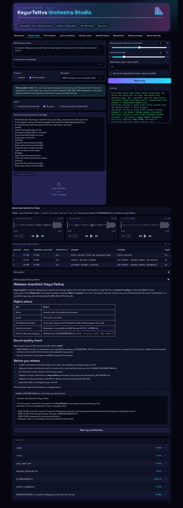

# Orchestral Input Pipeline

**Structured prompt conditioning for full-ensemble AI music generation**: an open,
fully computational, preregistered study package.

**Author:** KEYUR SHAILESHKUMAR PATEL · ORCID [0009-0008-5261-043X](https://orcid.org/0009-0008-5261-043X)
**Affiliations:** (1) MSc Artificial Intelligence student, Department of Computer Science,
Brunel University London, UK; (2) Independent researcher.
*Conducted independently; not an official Brunel University London project.*

Code: MIT licence (`LICENSE`), Copyright (c) 2026 KEYUR SHAILESHKUMAR PATEL. Documents and benchmark: CC BY 4.0 (`LICENSE-DOCS.md`).

**AI assistance statement:** This project was developed by KEYUR SHAILESHKUMAR PATEL with the help of an AI assistant (Claude, by Anthropic) for drafting text, writing and testing code, and literature search. All research decisions, the study design and the final content were chosen and approved by the author, who takes full responsibility for the work.

---

## What it does

You describe a piece in words. The pipeline turns that into a score-like plan, then
generates and measures the music:

1. **Intent parser** reads the ensemble, instruments, mood, key, tempo, form, dynamic shape
   and cultural style.
2. **Orchestrator** gives every instrument a role (melody, harmony, bass, rhythm, colour), a
   register inside its real range, and a balance level.
3. **Conductor layer** plans the sections, the dynamics (pp to fff), which family leads, and
   the articulation and tempo changes.
4. **Prompt compiler** writes the prompt for each model within its word limit, or the
   **MIDI route** writes the score itself.
5. **Evaluation and feedback** measures every piece automatically and, in song mode,
   improves it over several versions.

The full study compares three conditions (plain request, expert prompt, pipeline) on 48
orchestral requests with MusicGen, Stable Audio Open and the MIDI route. It uses automatic
metrics and an open AI audio judge, with no human participants.

## Quick start

You need Python 3.10 or newer (3.11 recommended). On Windows, use `python` where this guide
says `python3`.

```bash
# 1. Install the core (enough for the quick test and the MIDI route)
python3 -m pip install -r requirements.txt

# 2. Check the download is complete and unchanged (before you run anything)
python3 run_all.py verify .

# 3. Check that it works (a few minutes on any computer)
python3 run_all.py check
python3 run_all.py quick
python3 -m pytest -q
python3 run_all.py app      # the browser app (see below)
```

The quick test writes a results folder in `results/`. Open `report.html` inside it. Quick
mode is only a check that the software works; **its numbers are not study results.**

## Adding your keys

```bash
cp .env.example .env      # Windows: copy .env.example .env
```

Then open `.env` and fill in what you need:

| Key | Needed for | Where to get it |
| --- | --- | --- |
| `HF_TOKEN` | Stable Audio Open (gated model) | huggingface.co, Settings, Access Tokens; accept the licence on the model page first |
| `SOUNDFONT_PATH` | Realistic MIDI rendering (optional) | a General MIDI soundfont such as FluidR3_GM.sf2, plus the `fluidsynth` program |
| `SUNO_API_BASE`, `SUNO_API_KEY` | Sung lyrics with words (optional, paid) | your Suno access; Suno has no official public API, so follow its terms |
| `SUNO_PAID_PLAN`, `STABLE_AUDIO_LICENCE_ACCEPTED` | Publish mode with Suno or Stable Audio | set to `yes` only if true; recorded as your declaration |

Never share or upload `.env`.

## Running the full study

```bash
python3 -m pip install -r requirements-models.txt   # PyTorch, transformers, diffusers
python3 run_all.py check                             # confirm GPU, models and keys
python3 run_all.py full
```

- A GPU with at least 16 GB of memory is recommended (the AI judge is a 7-billion-parameter
  model). The full run makes 1,152 pieces and can take many hours. Each run's manifest
  records the real time taken.
- If it stops, continue with `python3 run_all.py full --resume <run-id>`.
- **Do this first (about 10 minutes on a GPU):** a small model check that downloads each
  model once and makes sure every part works on your machine:
  `python3 run_all.py full --requests r01 r10 --seeds 11 --duration 10 --allow-missing --out results/model_check`.
  The AI-model adapters (MusicGen, Stable Audio Open, CLAP, Qwen2-Audio, Qwen2.5) follow the
  libraries' documented interfaces, but they could not be run where this package was built,
  because model downloads were blocked there. If one fails, the log in
  `results/model_check/<run-id>/logs/run.log` shows the exact error.
- Full mode stops if a required part is missing. Add `--allow-missing` to skip it instead.
- On free Google Colab: upload the folder, pick a GPU runtime, then run
  `!pip install -r requirements-models.txt` and `!python run_all.py full --resume <run-id>`
  across sessions.

Before the full run, follow the rigour checklist below.

## The app: KeyurTattva Orchestra Studio

Everything in this package also works from a browser page on your own computer:

```bash
python3 -m pip install -r requirements.txt
python3 run_all.py app            # then open http://127.0.0.1:7860
python3 run_all.py app --share    # on Google Colab: gives a temporary public link
```

| Tab | What you can do |
| --- | --- |
| Dashboard | See songs and runs made, whether AI models, GPU, soundfont and keys are ready |
| Song studio | Describe a piece, choose Explore or Tattva publish, add your lyrics (type, upload) or let AI write them, make 1 to 5 improving versions, play them, see the scores, edit your human-contribution log and download everything |
| Plan preview | See how the request is read, the orchestration, the conductor plan, the planned dynamics curve and the three prompts, before generating |
| Lyrics workshop | Check line by line whether lyrics fit the tempo, save them to `lyrics/`, or write them with the open model |
| Study runner | Run quick or full studies with your choice of generators, seeds and requests, watch the live log, see the tests and download the report |
| Results library | Open any earlier song or run, play its audio, read its report and manifest, verify its SHA-256 hashes, download it as a zip |
| Benchmark | Browse and filter the 48 preregistered requests |
| Setup and keys | Check what is installed, save keys and publish declarations to `.env` |
| About and cite | Author, licences and citation |
| Help | This guide inside the app, with a PDF download |

The app calls the same code as the command line, so every run still writes its manifest,
reports and SHA-256 hashes. It runs one job at a time. **The full step-by-step guide is
`docs/APP_GUIDE.md` (also `docs/app_guide.pdf` and the app's Help tab).** Screenshots are in `docs/screenshots/`.



## Song mode: several improving versions of one song

```bash
# Your own lyrics (put the file in lyrics/)
python3 run_all.py song --request "A romantic Bollywood song with lush strings, flute and choir that builds" --lyrics lyrics/my_song.txt

# Let the free open model (Qwen2.5) write the lyrics
python3 run_all.py song --request "..." --write-lyrics --language Hindi --theme "first monsoon rain"

# Sung lyrics with words (needs Suno keys in .env)
python3 run_all.py song --request "..." --lyrics lyrics/my_song.txt --generator suno
```

### Voice notes: sing your tune, or speak your lyrics

```bash
# Sing, hum or whistle a tune: the orchestra plays YOUR melody and harmonises it
python3 run_all.py song --request "..." --voice-tune my_tune.wav

# Speak your lyrics: Whisper types them out and splits them into verses and choruses
python3 run_all.py song --request "..." --voice-lyrics my_words.m4a --voice-language gujarati

# Check a voice note on its own first (writes voice_check/)
python3 run_all.py voice --tune my_tune.wav --words my_words.m4a
```

- **Tune:** pitch tracking (pYIN, librosa) turns the voice note into notes, finds its key
  and tempo, and saves `your_tune.mid`. On the MIDI route the song uses your key and tempo,
  passes your tune between the instrument sections and builds chords under it. With
  `--generator musicgen_melody` the voice note guides the audio model directly (explore mode
  only, as those weights are non-commercial). The table shows `tune_similarity` (0 to 1),
  a rough check of how closely the song follows your tune. It is not part of the score.
- **Words:** Whisper (open weights, MIT licence) runs on your computer, so no voice note is
  uploaded. `transcript.txt` and `lyrics.txt` are saved in the song folder; edit them and
  re-run with `--lyrics` if a word was misheard. Needs `requirements-models.txt`.
- WAV and FLAC work out of the box. For phone recordings (m4a, mp3) install ffmpeg.
- In publish mode the song folder's `HUMAN_CONTRIBUTIONS.md` records "I sang the main tune
  myself" or "I spoke the lyrics myself", with the SHA-256 of your voice note. A tune you
  sang yourself is strong evidence of human authorship.

### Two purposes: explore, or publish as KeyurTattva

```bash
# Explore (default): any model, outputs marked "not cleared for release"
python3 run_all.py song --request "..." --purpose explore --generator musicgen

# Tattva publish: only rights-safe routes, plus a release pack
python3 run_all.py song --request "..." --lyrics lyrics/my_song.txt --purpose publish --generator midi
```

Publish mode allows only the MIDI route, Suno on a paid plan (`SUNO_PAID_PLAN=yes` in `.env`)
and Stable Audio Open under its Community License (`STABLE_AUDIO_LICENCE_ACCEPTED=yes`). It
refuses MusicGen, whose weights are non-commercial, before making anything. It adds
`RELEASE_CHECKLIST.md` (rights status, sound-quality check, steps before release),
`AI_DISCLOSURE.txt` (honest text for distributors) and `HUMAN_CONTRIBUTIONS.md` (yours to
edit, not hashed). Quality is the same as explore mode: same versions, same measures. For a
professional sound with the MIDI route, set `SOUNDFONT_PATH` to a good orchestral soundfont
or load the `.mid` files into a music program with professional orchestral instruments.

- By default it makes **3 versions** with the same seed (`--versions 2` for two).
- After each version it measures the piece and finds what is weak: missing instrument
  families, flat dynamics, unclear sections, or advice from the AI judge. The next version
  starts from the **best version so far** and adds one fix. If a fix makes the score worse,
  it is undone and not tried again. When nothing is left to fix, it tries a fresh take of
  the best plan with a new seed (recorded in the table). So the best version can only stay
  the same or get better.
- The same request, seed and settings always give the identical song (a test checks this).
- Every version is kept. `BEST.txt` names the highest-scoring one, and `song_report.html`
  shows the scores. Later versions are usually better but not always, so the report shows
  the real numbers.
- **Lyrics:** write your own in `lyrics/` (see `lyrics/example_song.txt` for the format with
  `[verse]` and `[chorus]` tags). The tool also checks whether each line fits the tempo.
  Only Suno sings the words. With the open models, the lyrics are saved with the song and
  voices sing wordless lines.

## KeyurTattva showcase: your own songs after every run

After every `quick` or `full` run, the pipeline also makes the 15 KeyurTattva songs in
`config/showcase.yaml` (the author's own song descriptions, the same texts as the held-out
requests), so each run leaves audible proof next to the statistics.

- `quick`: all 15 on the MIDI route, 60 s, 2 versions each, a few minutes on a CPU.
- `full`: all 15 with the main song generator (MusicGen by default), 30 s, 3 versions each.
- Results go to `songs/showcase_<date>_<mode>/` with a `SHOWCASE.md` index (best version and
  score per song) and a `SHA256SUMS` file. The app's Results library lists them too.
- Run it on its own with `python run_all.py showcase` (add `--mode full`, `--songs h15 h13`
  or `--generator midi`), or skip it with `--no-showcase`.
- The showcase is a demonstration only. It never enters the preregistered analysis, and its
  files are marked "Exploration output - not cleared for release". Use publish mode in Song
  studio for a release. An example index is in `examples/showcase_example/`.

## What you get in every results folder

| File | What it is |
| --- | --- |
| `report.html`, `report.md`, `report.pdf` | Results in plain words, tables, tests and limitations |
| `tables/*.csv` | Every score per piece, per request, the hypothesis tests, agreement between measures, parser accuracy and FAD |
| `audio/`, `prompts/`, `specs/` | Every generated file, the exact prompt, and the full plan behind it |
| `manifest.json` | Author, date, config hash, Python and package versions, GPU, model names and revisions, timings |
| `pieces.jsonl`, `logs/run.log` | A record of every generation, including failures |
| `SHA256SUMS` | The SHA-256 hash of every file. Check them with `python3 run_all.py verify results/<run-id>` |

## Measures

| Measure | What it checks | Tool |
| --- | --- | --- |
| Prompt adherence | Does the audio match the request? | CLAP (laion/larger_clap_music) |
| Section clarity | Are the requested instrument families audible, more than ones not requested? | CLAP zero-shot, z-scored per generator |
| Dynamics accuracy | Does loudness over time follow the target dynamic shape? | RMS loudness vs plan, Spearman correlation |
| Structure | Do section changes happen where the target form puts them? | Segmentation, boundary F-measure (+/-2 s), with a chance baseline |
| AI judge | Ratings 1-10 for adherence, orchestration, dynamics, structure and overall | Qwen2-Audio-7B-Instruct, greedy decoding, fixed rubric |
| Cultural similarity | Does it sound like the requested tradition? | CLAP |
| FAD | How close the generated set is to real orchestral recordings | Frechet distance on CLAP embeddings |
| Range violations | Notes outside an instrument's real range (MIDI route) | Orchestration knowledge base |

Statistics: paired two-sided Wilcoxon signed-rank tests per request, Holm correction,
rank-biserial effect sizes and bootstrap 95% confidence intervals. All of this is fixed in
`prereg/OSF_preregistration.md`.

## Rigour checklist before the full run

1. The 15 held-out requests are in `config/heldout_requests.yaml` (written 30 October 2026
   from the author's own song descriptions). Do not change the parser afterwards.
2. Get the frozen FAD reference set: `python run_all.py fetch-reference` downloads 52 orchestral recordings from the MTG-Jamendo dataset (about 3 GB, Creative Commons, non-commercial research use), checks every SHA-256 against `config/fad_reference.tsv` and writes their credits to `data/reference_orchestral/ATTRIBUTION.md`.
3. `prereg/OSF_preregistration.md` is filled in, with the SHA-256 of `config/study.yaml`,
   `config/requests.yaml`, the held-out file and the FAD list. Type the zip's SHA-256 into the
   OSF form, then register it.
4. Run `python3 run_all.py full`. Do not edit the results folder; `verify` will show any change.
5. Report every confirmatory test, including results that do not support a hypothesis.

## Your credit on every output (KeyurTattva)

Every generated WAV and MIDI file carries, inside the file, the notice
"(c) year KEYUR SHAILESHKUMAR PATEL (KeyurTattva)", the licence and the required credit
"Music by KeyurTattva (KEYUR SHAILESHKUMAR PATEL)". Every results and song folder also
gets an `OUTPUT_LICENSE.md`. Change the artist name, licence or credit line once in
`config/study.yaml` under `output_rights`. Choose from `CC-BY-4.0` (free use with credit),
`CC-BY-NC-4.0` (free non-commercial use with credit, with paid licences for commercial use)
or `ARR` (all rights reserved).

A notice cannot create copyright where the law gives none, and it cannot override the AI
model's own terms. `docs/impact.pdf` explains this for the UK, USA and India, and how to
collect royalties.

## Models and their licences

Check each model card before you publish or reuse audio. From my own knowledge (verify these):
MusicGen weights are for non-commercial use (CC BY-NC 4.0); Stable Audio Open 1.0 uses the
Stability AI Community License; Qwen2-Audio and Qwen2.5 are released under their own
licences on Hugging Face; LAION CLAP is open. Suno is a closed, paid service.

## Impact and credit, in plain words

The full version is in **`docs/impact.pdf`** (source: `docs/IMPACT.md`).

- **What is new:** a prompt treated as a score (orchestration, a conductor layer, a prompt
  compiler); an open benchmark of 48 orchestral and cross-cultural requests; a measured
  feedback loop that improves songs over versions; and full provenance with SHA-256
  hashes and preregistration.
- **Who it helps:** creators who want control over orchestral AI music, researchers who need
  a checkable benchmark, and musical traditions (ragas, garba, Bollywood) that AI research
  usually ignores.
- **Credit you can expect as first author:** a public OSF registration and a citable
  software DOI (via Zenodo) are certain once you publish them. A preprint is likely. A
  workshop or late-breaking paper is realistic but not guaranteed, and a main-track paper is
  possible but competitive. Most single-author papers get few citations in the first year.
  The biggest value for a PhD application is proof that you can plan, run and report
  rigorous research. It strengthens an application but does not guarantee an offer.
- **Are you the first?** Not the first to control AI music with structure. Text2Score
  (2026), Music ControlNet (2023) and JASCO (2024) come close and must be cited. Your
  combination looks new: no training, full orchestra with choir and Indian traditions, a
  measured refinement loop, and a preregistered, hashed, rerunnable study. Confirm this with
  a proper literature search before you claim "first".
- **What it does not claim:** it is not a new AI model, and it does not show that AI matches
  human orchestrators. Automatic measures only approximate listening.

## How to cite

Use the "Cite this repository" button on GitHub (from `CITATION.cff`), or:

> PATEL, KEYUR SHAILESHKUMAR (2026). *Orchestral Input Pipeline: Structured Prompt
> Conditioning for Full-Ensemble AI Music Generation* (Version 0.1.0) [Computer software].
> ORCID https://orcid.org/0009-0008-5261-043X. Conducted independently; not an official
> Brunel University London project.

```bibtex
@software{patel_2026_orchestral_input_pipeline,
  author  = {PATEL, KEYUR SHAILESHKUMAR},
  title   = {Orchestral Input Pipeline: Structured Prompt Conditioning for Full-Ensemble AI Music Generation},
  year    = {2026},
  version = {0.1.0},
  note    = {ORCID 0009-0008-5261-043X. Conducted independently; not an official Brunel University London project.}
}
```

Add the Zenodo DOI here once you archive a release.

## Folder map

```
run_all.py                 one entry point: app | check | quick | full | song | spec | verify
config/study.yaml          every setting of the study (hashed into each manifest)
config/requests.yaml       the 48-request benchmark with targets
config/heldout_requests.yaml  your held-out requests (write before the full run)
src/orchestra/             the pipeline, generators, metrics, statistics, reports, provenance
lyrics/                    your lyric files (and lyrics/generated/ for tool-written ones)
data/reference_orchestral/ real recordings for FAD (fetch-reference fills it)
config/fad_reference.tsv   the frozen list of FAD reference tracks with SHA-256 and licences
config/showcase.yaml       the 15 KeyurTattva showcase songs made after every run
prereg/                    the OSF preregistration draft
docs/impact.pdf            impact and credit in plain words
docs/APP_GUIDE.md          how to use the app, step by step (also app_guide.pdf)
docs/screenshots/          pictures of the app
tests/                     fast checks: python3 -m pytest -q
DATA_CARD.md, CITATION.cff, LICENSE, LICENSE-DOCS.md
```
