# KeyurTattva Orchestra Studio: app guide

KEYUR SHAILESHKUMAR PATEL · ORCID 0009-0008-5261-043X · Orchestral Input Pipeline v0.1.0  
MSc Artificial Intelligence student, Department of Computer Science, Brunel University London, UK; Independent researcher.  
*Conducted independently; not an official Brunel University London project.* Licence of this guide: CC BY 4.0.

**AI assistance statement:** This project was developed by KEYUR SHAILESHKUMAR PATEL with the help of an AI assistant (Claude, by Anthropic) for drafting text, writing and testing code, and literature search. All research decisions, the study design and the final content were chosen and approved by the author, who takes full responsibility for the work.

## 1. What the app is

KeyurTattva Orchestra Studio is a page in your web browser that runs every part of the Orchestral Input Pipeline. You describe a piece in words. The app plans it like a score, makes the music, measures it, improves it over several versions and saves everything with your credit and SHA-256 hashes. It runs on your own computer, so nothing is uploaded anywhere unless you choose a paid service such as Suno.

The app and the command line use the same code. A song or study made in the app has the same manifest, reports and hashes as one made with `python run_all.py`.

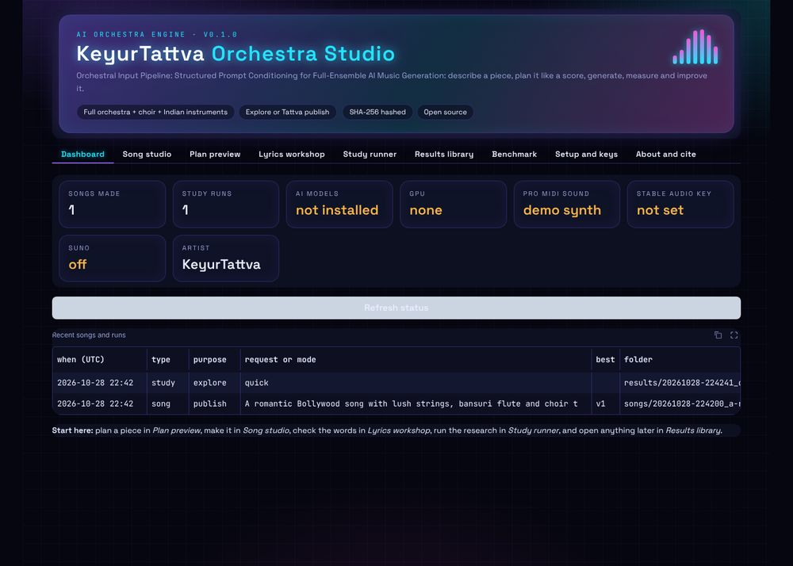

## 2. Install and open the app

You need Python 3.10 or newer (3.11 recommended). On Windows, type `python` where this guide says `python3`.

1. Unzip the package and open a terminal in its folder (`orchestra-pipeline`).
2. Install the core parts, including the app: `python3 -m pip install -r requirements.txt`
3. Check the download is complete and unchanged: `python3 run_all.py verify .`
4. Start the app: `python3 run_all.py app`
5. Open **http://127.0.0.1:7860** in your browser. Keep the terminal open while you use the app.
6. To stop the app, go back to the terminal and press `Ctrl + C`.

**For the AI models** (MusicGen, Stable Audio Open, the CLAP measures, the AI judge and the lyrics writer), also run `python3 -m pip install -r requirements-models.txt`. These need a GPU with at least 16 GB of memory for the biggest models. Without them, the app still works with the MIDI route.

**On free Google Colab:** upload the folder, choose a GPU runtime, run `!pip install -r requirements.txt -r requirements-models.txt`, then `!python run_all.py app --share`. Colab prints a temporary public link that opens the app. Anyone with that link can use it while it runs, so do not share it.

Other options: `--port 8000` uses another port, and `--host 0.0.0.0` lets other devices on your home network open it.

## 3. Your first song in five minutes

1. Open the **Song studio** tab.
2. Keep the example request, or pick one from **Or start from an example**.
3. Choose **Tattva publish** and the **MIDI route** generator. This works on any computer.
4. Under **Lyrics**, choose **My lyrics** to try the example lyrics, or keep it instrumental.
5. Press **Make song** and watch the **Live log**. A 30-second song with 3 versions takes about a minute.
6. Play the versions. The one marked **(best)** has the highest score. Download it, or download the whole folder as a zip.

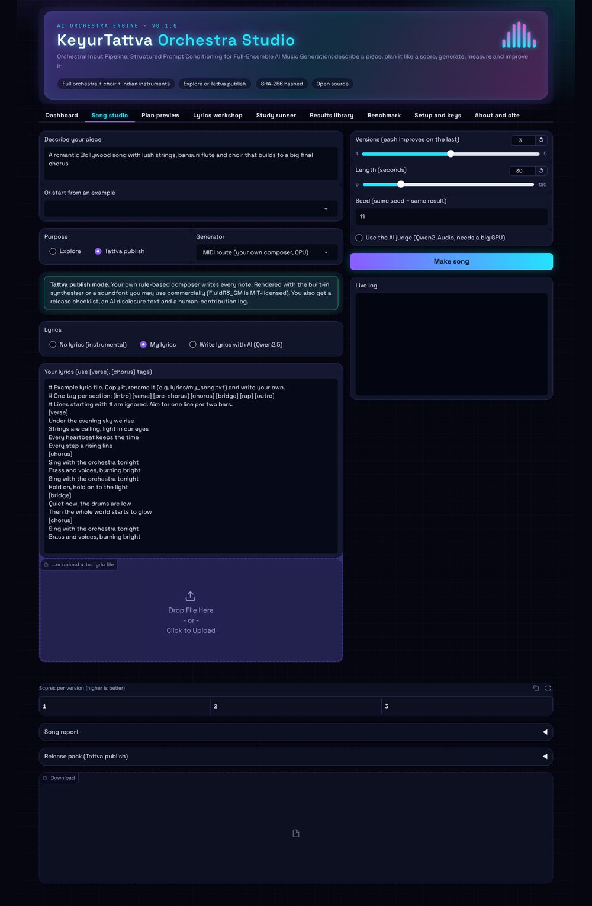

## 4. The tabs, one by one

The app has ten tabs. Only one long job (a song or a study) runs at a time. If you start a second one, the app asks you to wait.

### 4.1 Dashboard

The Dashboard shows how many songs and study runs you have made and whether each part is ready.

| Card | Ready when | If it is not ready |
| --- | --- | --- |
| AI models | torch and transformers are installed | Install `requirements-models.txt` |
| GPU | A CUDA graphics card is found | Use the MIDI route, or Google Colab with a GPU |
| Pro MIDI sound | `SOUNDFONT_PATH` points to a soundfont and FluidSynth is installed | The built-in demo synthesiser is used |
| Stable Audio key | `HF_TOKEN` is set | Add it in *Setup and keys* |
| Suno | `SUNO_API_KEY` is set | Suno is optional and paid |

The **Recent songs and runs** table lists your last 15 folders, newest first. Press **Refresh status** after changing keys or installing parts.

### 4.2 Song studio

This is where you make songs. Fill in the left side, set the options on the right, then press **Make song**.

**Describe your piece.** Write it the way you would brief a composer: the instruments, mood, culture or style, and how it should change over time. For example: "A romantic Bollywood song with lush strings, bansuri flute and choir that builds to a big final chorus." Words such as *builds*, *fades*, *quietly*, *climax*, *raga*, *garba*, *overture* or *march* change the plan. Use *Plan preview* to see how your words were read.

**Purpose.** This decides what you may do with the result.

| | Explore | Tattva publish |
| --- | --- | --- |
| Use it for | Trying ideas and research | Music you will release as KeyurTattva |
| Generators allowed | All four | MIDI route; Stable Audio Open and Suno after your declaration; MusicGen is blocked |
| Mark inside each file | "Exploration output - not cleared for release" | "Tattva publish mode" and why it is cleared |
| Extra files | None | Release checklist, AI disclosure, human-contribution log |

The coloured box under Purpose updates as you choose. Green means cleared, amber means explore only, and red means blocked. If it asks for a declaration, tick it in *Setup and keys*.

**Generator.**

| Generator | Needs | Publish? | Notes |
| --- | --- | --- | --- |
| MIDI route | Nothing (CPU) | Yes | Your own rule-based composer writes every note. It also saves a `.mid` file you can open in any music program |
| MusicGen | GPU, AI models | No (non-commercial weights) | Open model; good for exploring |
| MusicGen-melody | GPU, AI models, a sung voice note | No (non-commercial weights) | Follows the tune you sing; explore only |
| Stable Audio Open | GPU, AI models, `HF_TOKEN` | Yes, after the declaration | Accept the licence on its Hugging Face page first |
| Suno | Suno keys, paid plan | Yes, after the declaration | The only option that sings your words; it cannot be re-run exactly |

**Lyrics.**

- **No lyrics:** an instrumental piece. Choirs sing wordless lines.
- **My lyrics:** type or paste your lyrics, or upload a `.txt` file. Put each section under a tag on its own line: `[intro]`, `[verse]`, `[pre-chorus]`, `[chorus]`, `[bridge]`, `[rap]` or `[outro]`. Lines starting with `#` are ignored. The app saves a copy in `lyrics/` and in the song folder.
- **Write lyrics with AI (Qwen2.5):** a free open model writes them, in the language and on the theme you give. It needs the AI models and a GPU. AI-written lyrics have weak copyright on their own, so rewrite them in your own words before release.

Only Suno sings words. With the other generators, the lyrics are kept with the song for your records.

**Voice notes: sing your tune or speak your lyrics.** Open this section under the lyrics box.

- **Sing your tune:** record with the microphone or upload a file. Sing, hum or whistle a short phrase, close to the microphone. Press **Hear the tune I found** to check the notes, key and tempo the app heard, played back on a flute. When you make the song, the orchestra uses your key and tempo, plays your tune across the sections and builds chords under it. A `your_tune.mid` file is saved with the song.
- **Speak your lyrics:** record or upload the words, choose the language (or leave it on auto) and press **Type out my words**. Whisper writes them out, splits them into verses and choruses, puts them in the lyrics box and sets *My lyrics*. Correct any misheard word before you press **Make song**. You can also choose *From my voice note (spoken)* as the lyrics option.
- Everything runs on your computer; voice notes are not uploaded. Phone recordings (m4a, mp3) need ffmpeg installed.
- The results table adds **tune_similarity** (0 to 1), a rough check of how closely the song follows your tune. It is not part of the score.
- In Tattva publish mode, the human-contribution log records that you sang the tune or spoke the lyrics yourself.

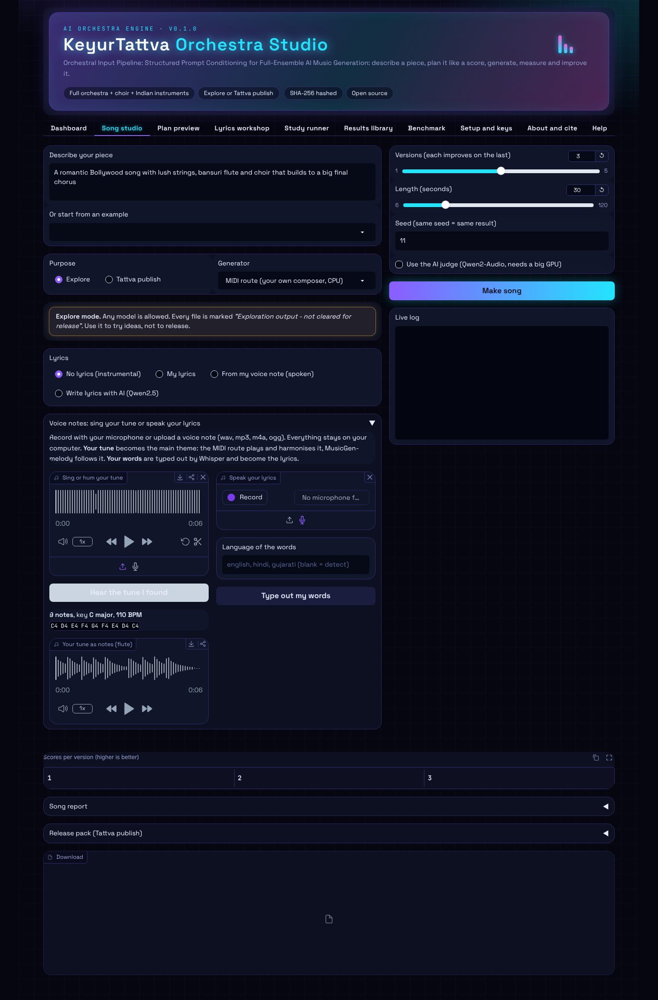

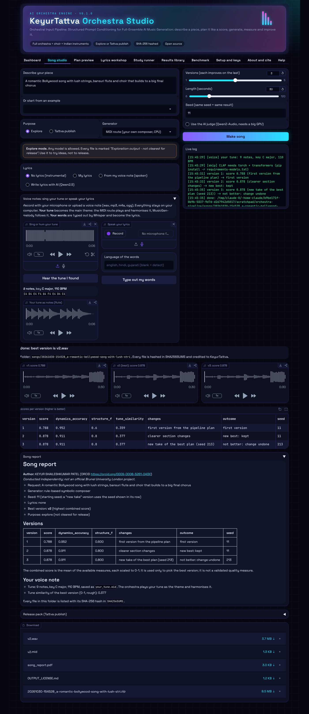

**Versions, length, seed and judge.**

- **Versions (1 to 5):** each version starts from the best one so far and adds one fix for its weakest area. A fix that lowers the score is undone and not tried again. When nothing is left to fix, the app tries a fresh take of the best plan with a new seed. Your best version can only stay the same or get better.
- **Length:** 6 to 120 seconds. Longer pieces take longer and need more GPU memory.
- **Seed:** the same request, settings and seed always give the identical song. Change it for a different take.
- **Use the AI judge:** Qwen2-Audio listens and scores each version from 1 to 10, and gives advice that the next version uses. It needs a GPU with about 16 GB of memory.

**Reading the results.** When the log says *done*, the app shows:

- **A player for each version.** The label shows its score, and **(best)** marks the highest.
- **Scores per version.** Higher is better. Columns appear only when their measure ran.

| Column | Meaning | Range |
| --- | --- | --- |
| score | Combined score used to pick the best version | 0 to 1 |
| prompt_adherence | How well the audio matches your words (CLAP) | about 0 to 0.6 |
| section_clarity_raw | Are the requested instrument families audible, more than others? | 0 to 1 |
| dynamics_accuracy | Does the loudness follow the planned shape? | -1 to 1 |
| structure_f | Do section changes happen where the plan puts them? | 0 to 1 |
| judge_overall | The AI judge's overall rating | 1 to 10 |
| changes | What this version changed | text |
| outcome | Kept as new best, or undone | text |
| seed | The seed this version used | number |

- **Song report:** the full report, also saved as PDF and HTML.
- **Release pack (Tattva publish only):** the release checklist with an honest sound-quality check, and an editor for `HUMAN_CONTRIBUTIONS.md`. Write what you did by hand, such as re-recording, mixing, editing or rewriting lines, and press **Save my contributions**. This file is yours to edit, so it is left out of the hash check.
- **Download:** the best WAV and MIDI files, the report PDF, the release files, the licence, and a zip of the whole song folder.

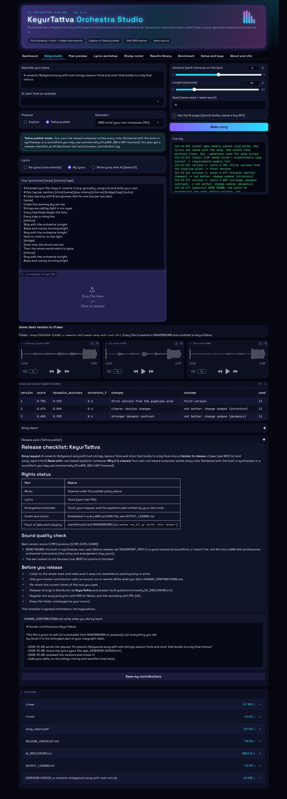

### 4.3 Plan preview

Plan preview shows how the pipeline reads a request, before anything is generated.

1. Type a request, choose the length, and choose which generator's word limit to use for the prompts.
2. Press **Plan it**.
3. Read the summary: ensemble, instrument families, mood, scale, tempo, form, dynamic shape and culture.
4. **Orchestration** lists every instrument with its role (melody, countermelody, harmony, bass, rhythm), its register as MIDI note numbers inside the real playing range, and its balance.
5. **Conductor plan** lists the sections with start and end times, dynamic mark (pp to fff), lead family, active families and articulation.
6. **Planned dynamics** draws the target loudness curve over time.
7. The three prompts show the *plain* request, the *expert* prompt and the *pipeline* prompt that the study compares. The full plan is available as JSON.

If the summary missed something, add a clearer word to the request (for example "with choir" or "fades out at the end") and plan it again.

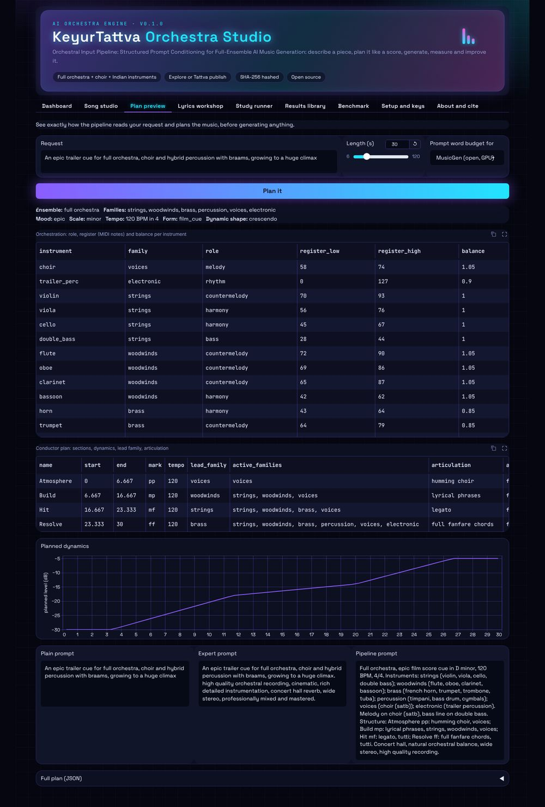

### 4.4 Lyrics workshop

Use the Lyrics workshop to write and check lyrics before making a song.

1. Type or paste lyrics, or open a `.txt` file.
2. Put the song request in the box on the right. It sets the tempo and metre.
3. Press **Check fit**. The table shows each line, its syllable count, and whether it fits (aim for the range shown, about one line per two bars).
4. Shorten lines marked *too long* and lengthen lines marked *short*.
5. Give the file a name and press **Save to lyrics/**. Then choose it in *Song studio* under **My lyrics**.

**Write with AI** asks the open model for new lyrics in your language and on your theme. It needs a GPU.

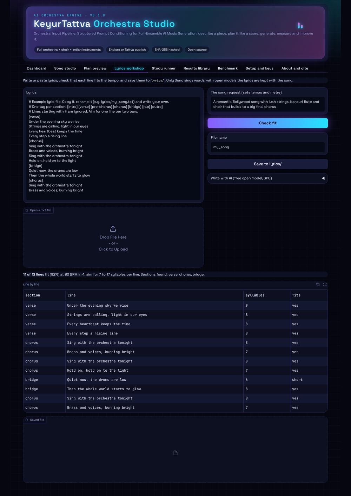

### 4.5 Study runner

The Study runner runs the research study: the same requests under three prompt conditions, measured and tested statistically.

- **quick** is a few-minute check that the software works (MIDI route, 4 requests, 12-second pieces). **Its numbers are not study results.**
- **full** is the preregistered study: 48 requests, 3 seeds, 3 generators. It needs a GPU and can take many hours.

Options: generators, seeds (for example `11 22 33`), requests, length (0 uses the config), **No AI judge**, and **Skip unavailable parts** (useful for a first model check). **Resume** continues a run that was interrupted.

When the run finishes you see the hypothesis tests, a summary by generator and condition, the full report, and downloads (report PDF, HTML and the whole run as a zip). Before the full run, follow the rigour checklist in the README and register the study on OSF.

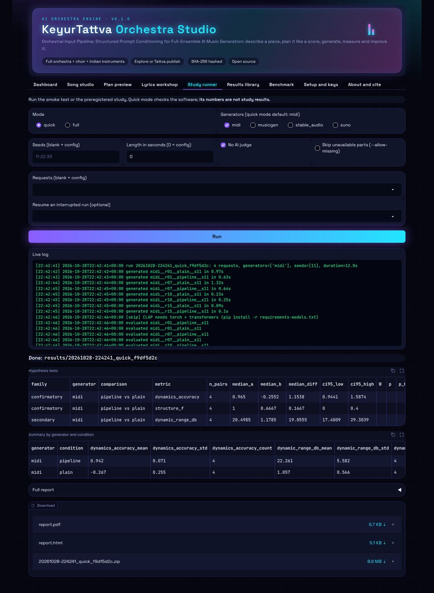

### 4.6 Results library

The Results library opens anything you made earlier.

1. Press **Refresh** and choose a song or run (newest first).
2. Press **Verify SHA-256 hashes**. "OK" means no file has changed since it was made. A changed or missing file is listed by name.
3. Choose any audio file under **Play a file** to listen.
4. Read the report, or open the manifest to see the author, date, software versions, settings, hashes and timings.
5. Press **Download as zip** to keep or share the whole folder.

After every quick or full run, the list also shows your **KeyurTattva showcase**: the 15 songs from `config/showcase.yaml`, made automatically as proof. Open `SHOWCASE.md` in the showcase folder to see the best version and score of each song.

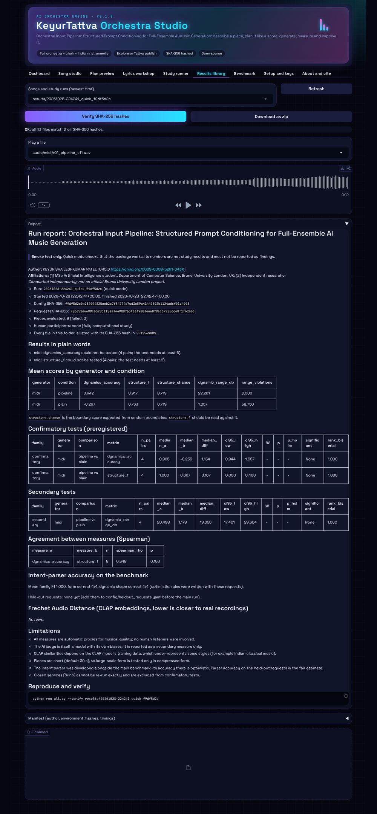

### 4.7 Benchmark

The Benchmark tab lists the 48 preregistered requests with their target instrument families, form, dynamic shape and culture. Type in **Filter** (for example *raga*, *brass* or *choir*) to narrow the list. These requests are fixed before the study, so only edit `config/requests.yaml` before you register.

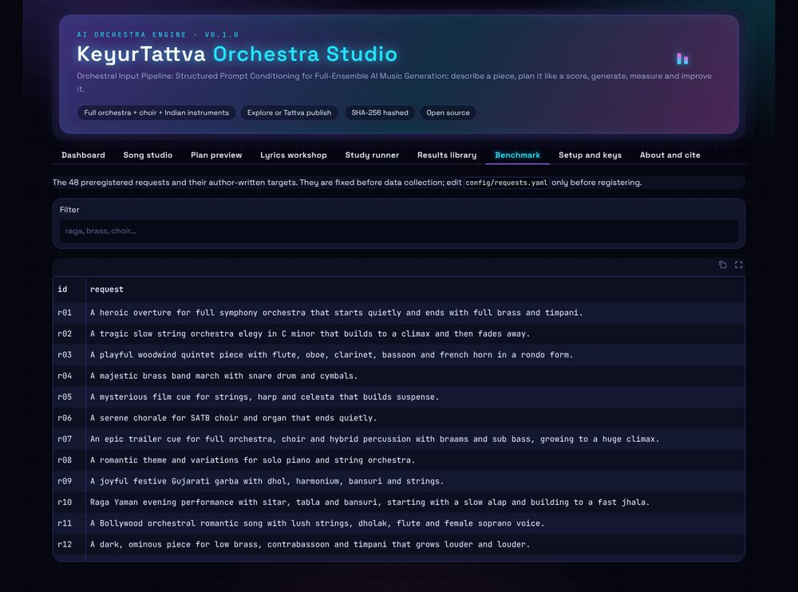

### 4.8 Setup and keys

- **Check my setup** lists what is installed and which keys are set.
- **Keys and declarations** saves to the `.env` file on your computer only. Never share or upload `.env`.

| Field | What it does |
| --- | --- |
| HF_TOKEN | Lets Stable Audio Open download (from huggingface.co, Settings, Access Tokens) |
| SOUNDFONT_PATH | A General MIDI soundfont file (for example FluidR3_GM.sf2) for realistic MIDI sound; also install the `fluidsynth` program |
| SUNO_API_BASE, SUNO_API_KEY | Your Suno access, for sung lyrics |
| Paid Suno plan (tick) | Your declaration that your Suno plan gives you ownership and commercial rights; needed for publish mode with Suno |
| Stability AI licence (tick) | Your declaration that you accepted the Stability AI Community License and are below its revenue limit; needed for publish mode with Stable Audio |

Tick a declaration only if it is true. Each publish-mode song records it in its manifest.

The **Credit on every output** box shows the artist, owner, licence and credit line stamped into every file. Change them in `config/study.yaml` under `output_rights`, before you register the study.

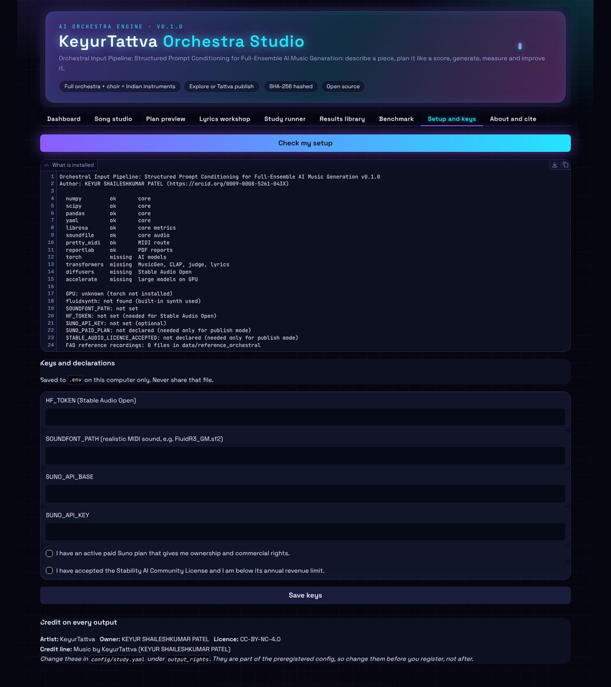

### 4.9 About and cite

About and cite shows the author, the licences and how to cite the software.

### 4.10 Help

Help shows this guide inside the app, with a button to download it as a PDF.

## 5. Where your files are saved

| Folder | What is in it |
| --- | --- |
| `songs/<date>_<request>/` | `v1.wav` and later versions, the `.mid` files (MIDI route), prompts, `versions.csv`, `BEST.txt`, song report (MD, HTML, PDF), `manifest.json`, `OUTPUT_LICENSE.md`, `SHA256SUMS`, and the release pack in publish mode |
| `results/<run id>/` | Every study piece in `audio/`, `prompts/`, `specs/`, `tables/*.csv`, report (MD, HTML, PDF), `manifest.json`, `pieces.jsonl`, `logs/run.log`, `SHA256SUMS` |
| `lyrics/` | Your lyric files; `lyrics/generated/` holds AI-written ones |
| `.env` | Your keys and declarations (private) |

Do not edit files inside a song or results folder (except `HUMAN_CONTRIBUTIONS.md`), or the hash check will show the change.

## 6. Getting a professional sound

- **MIDI route:** the built-in synthesiser is a demo sound. For release, set `SOUNDFONT_PATH` to a good orchestral soundfont and install FluidSynth. Or open the `.mid` file in a music program (for example a DAW with orchestral sample libraries) and play it with professional instruments. The notes and arrangement stay yours.
- **Sung songs:** use Suno on a paid plan.
- **Any route:** mix and master the best version, and record what you did in `HUMAN_CONTRIBUTIONS.md`. Human work makes the music better and strengthens your copyright claim.

## 7. Releasing as KeyurTattva

1. Make the song in **Tattva publish** mode.
2. Open `RELEASE_CHECKLIST.md` and work through it: listen for resemblance to existing songs, add your human contribution, and re-check the tool's current terms.
3. Use `AI_DISCLOSURE.txt` to answer the distributor's AI questions honestly.
4. Release as **KeyurTattva** and keep the song folder unchanged as your record.
5. Register the song and lyrics with PRS for Music, and the recording with PPL (UK).

This guide is general information, not legal advice. See `docs/impact.pdf` for copyright and royalties.

## 8. If something goes wrong

| What you see | What to do |
| --- | --- |
| The page does not open | Check the terminal shows "Running on local URL" and use that address; try `--port 8000` |
| "The app needs Gradio" | Run `python3 -m pip install -r requirements.txt` |
| "Another job is running" | Wait for the current song or study to finish |
| "Blocked in Tattva publish mode" | Choose the MIDI route, or Explore mode |
| "Needs your declaration" | Tick it in *Setup and keys* (only if true) and save |
| "[skip] CLAP needs torch + transformers" | Normal without the AI models: those columns are left out. Install `requirements-models.txt` for them |
| A model error in the log | Run the model check in the README; the exact error is in the log and in the run's `logs/run.log` |
| Out of GPU memory | Turn off the AI judge, shorten the piece, or use Colab with a larger GPU |
| The sound is basic | It is the demo synthesiser: see section 6 |
| Verify says "changed" | A file in that folder was edited after it was made; use an unchanged copy |

## 9. The same actions from the command line

| In the app | Command |
| --- | --- |
| Open the app | `python3 run_all.py app` |
| Make a song | `python3 run_all.py song --request "..." --purpose publish --generator midi` |
| Use your lyrics | add `--lyrics lyrics/my_song.txt` |
| AI-written lyrics | add `--write-lyrics --language Hindi --theme "first monsoon rain"` |
| Sing your tune | add `--voice-tune my_tune.wav` |
| Speak your lyrics | add `--voice-lyrics my_words.m4a --voice-language gujarati` |
| Check a voice note | `python3 run_all.py voice --tune my_tune.wav --words my_words.m4a` |
| Plan preview | `python3 run_all.py spec --request "..."` |
| Quick or full study | `python3 run_all.py quick` or `python3 run_all.py full` |
| Verify a folder | `python3 run_all.py verify songs/<folder>` |
| KeyurTattva showcase on its own | `python3 run_all.py showcase` (or `--mode full`) |
| Download the FAD reference recordings | `python3 run_all.py fetch-reference` |
| Check setup | `python3 run_all.py check` |
